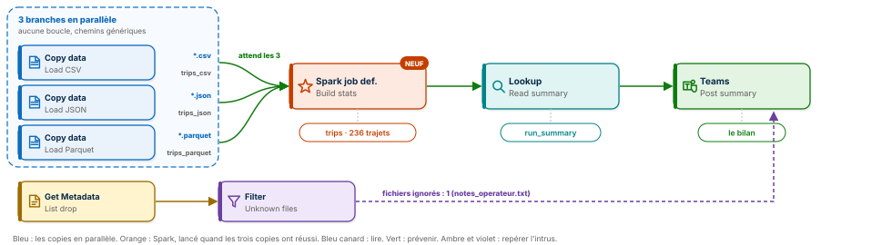
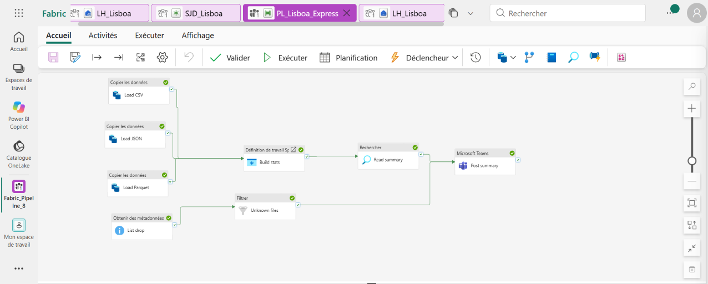
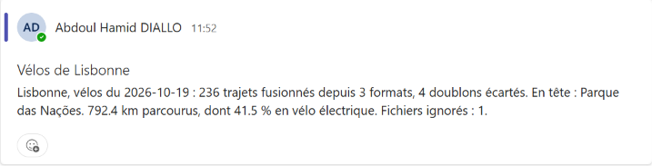
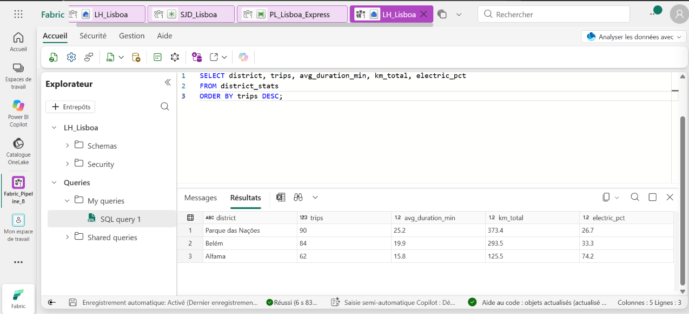
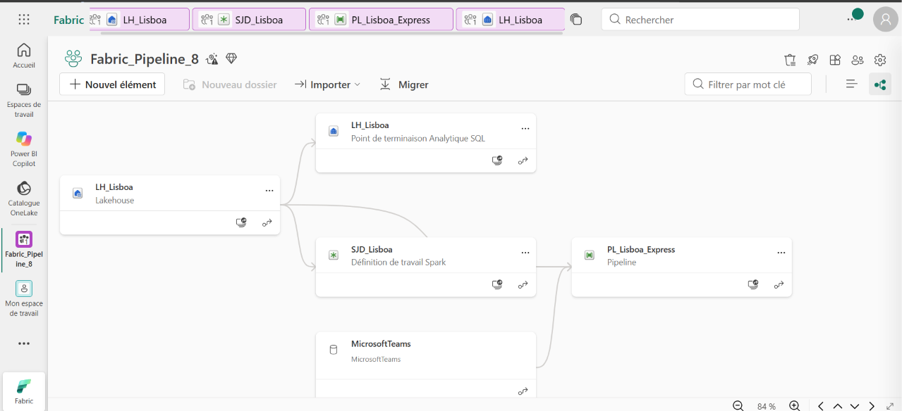

# 🚲 Fabric Pipeline Express 8 : charger en parallèle, unifier avec Spark, prévenir




Un pipeline Microsoft Fabric Data Factory qui reçoit les trajets de vélos en libre-service de trois quartiers de Lisbonne, chacun dans son format : CSV, JSON et Parquet. Trois copies partent en même temps, sans boucle. Un programme Spark, publié comme définition de tâche Spark, attend les trois, ramène tout dans les mêmes unités, écarte les doublons et désigne le quartier en tête. Un filtre repère le fichier qui n'a rien à faire là. Microsoft Teams reçoit le bilan.

**Guide PDF de 7 pages inclus** : [`Pipeline_Fabric_Guide_8_public.pdf`](Pipeline_Fabric_Guide_8_public.pdf). Chaque activité, chaque champ, chaque expression, et les chiffres à retrouver à l'unité près. Les expressions sont aussi dans [`data/expressions.txt`](data/expressions.txt) et le programme Spark dans [`spark/lisboa_stats.py`](spark/lisboa_stats.py).

## 📸 Aperçu

`PL_Lisboa_Express` après une exécution réussie : trois copies parallèles qui se rejoignent sur Spark, une branche qui liste et filtre le dossier, puis la lecture du verdict et le message Teams. Huit activités, huit coches vertes.



Le bilan publié dans Microsoft Teams, rédigé à partir de la ligne de synthèse écrite par Spark.



La table `district_stats` interrogée dans le point de terminaison SQL du lakehouse : trois quartiers, leurs trajets, leur durée moyenne, leurs kilomètres et la part du vélo électrique.



## 🎯 Résultats clés

| Indicateur | Valeur |
|---|---|
| Activités | 8 (Copy data ×3, Get Metadata, Filter, Spark job definition, Lookup, Microsoft Teams) |
| Nouveautés | Définition de tâche Spark, branches parallèles qui se rejoignent, chemins génériques, sources JSON et Parquet |
| Formats lus | 3 : CSV, JSON, Parquet, avec trois conventions d'unités |
| Lignes reçues | 240 (84 + 66 + 90) |
| Doublons écartés | 4 trajets déclarés à la fois par Belém et par Alfama |
| Trajets uniques | 236 |
| Kilomètres parcourus | 792,4 |
| Part du vélo électrique | 41,5 % sur la ville, 74,2 % à Alfama |
| Fichier inconnu repéré | 1, sans faire échouer le pipeline |

## 💼 Impact métier

Trois partenaires exploitent les vélos de Belém, d'Alfama et de Parque das Nações. Chacun exporte ses trajets à sa façon : un CSV en minutes et en kilomètres, un JSON en secondes et en mètres, un Parquet typé. Additionner ces fichiers tels quels donnerait des totaux faux, et un trajet qui traverse deux quartiers serait compté deux fois. Ce pipeline livre chaque soir un chiffre unique et juste par quartier, et le résultat parle : à Alfama, le quartier des collines, trois trajets sur quatre se font en vélo électrique, ce qui guide directement la répartition de la flotte.

## 📝 Résumé

`PL_Lisboa_Express` lance trois Copy data sans lien entre eux, donc en parallèle. Chacun lit le dossier `Files/drop` du lakehouse `LH_Lisboa` avec un chemin générique (`*.csv`, `*.json`, `*.parquet`) et remplace sa table brute. En même temps, Get Metadata liste le dossier et un Filter garde ce qui n'est ni CSV, ni JSON, ni Parquet. Quand les trois copies ont réussi, la définition de tâche Spark `SJD_Lisboa` unifie les unités, écarte les doublons par `trip_id` et écrit trois tables : `trips`, `district_stats` et `run_summary`. Un Lookup lit la ligne de `run_summary`, et Teams publie le bilan avec le nombre de fichiers ignorés.

## 🔁 Pipeline

| Activité | Type | Rôle |
|---|---|---|
| `Load CSV` | Copy data | `drop/*.csv`, DelimitedText avec en-tête, vers `trips_csv`, action Remplacer |
| `Load JSON` | Copy data | `drop/*.json`, tableau d'objets, vers `trips_json`, action Remplacer |
| `Load Parquet` | Copy data | `drop/*.parquet`, schéma lu dans le fichier, vers `trips_parquet`, action Remplacer |
| `List drop` | Get Metadata | Éléments enfants du dossier `Files/drop` |
| `Unknown files` | Filter | `@not(or(or(endswith(toLower(item().name), '.csv'), endswith(toLower(item().name), '.json')), endswith(toLower(item().name), '.parquet')))` |
| `Build stats` | Spark job definition | Lance `SJD_Lisboa` quand les trois copies ont réussi |
| `Read summary` | Lookup | Table `run_summary`, première ligne uniquement |
| `Post summary` | Microsoft Teams | Attend `Read summary` et `Unknown files`, puis publie le bilan |

## 🧠 Les quatre idées du projet

**Le parallèle sans boucle.** Des activités qu'aucune flèche ne relie s'exécutent en même temps. Pas besoin de ForEach pour trois sources connues : trois copies posées côte à côte suffisent.

**La jonction.** Une activité qui reçoit plusieurs flèches vertes attend qu'elles soient toutes vertes. `Build stats` démarre donc à la fin de la plus lente des trois copies, jamais avant.

**Le chemin générique.** Aucun nom de fichier n'est écrit en dur : `*.json` prend le fichier du jour, quel que soit son nom. Le même pipeline traitera le 20 octobre sans modification.

**Le code à part.** La logique de calcul vit dans un fichier Python, publié comme définition de tâche Spark. Il se versionne, se relit et se remplace sans ouvrir le pipeline.

## 🚦 Le pipeline en une image

| Étape | Dans un bureau de tri | Dans Fabric |
|---|---|---|
| 1 | Trois guichets reçoivent chacun un format, en même temps | Trois Copy data en parallèle |
| 2 | Le portier repère le colis qui n'a rien à faire là | Get Metadata puis Filter |
| 3 | L'expert attend les trois guichets, met tout dans la même unité, élimine les doublons | Définition de tâche Spark |
| 4 | Le registre garde la ligne de synthèse | Lookup sur `run_summary` |
| 5 | Le haut-parleur annonce le bilan | Microsoft Teams |

## 🧬 Traçabilité

```
LH_Lisboa / Files / drop
   ├─ belem_2026-10-19.csv       ──▶ Copy data Load CSV      ──▶ trips_csv       84 lignes, tout en texte
   ├─ alfama_2026-10-19.json     ──▶ Copy data Load JSON     ──▶ trips_json      66 lignes, secondes et mètres
   ├─ parque_2026-10-19.parquet  ──▶ Copy data Load Parquet  ──▶ trips_parquet   90 lignes, typées
   └─ notes_operateur.txt        ──▶ Get Metadata + Filter   ──▶ 1 fichier ignoré
                                         │
                       les trois copies réussies
                                         ▼
Spark job definition SJD_Lisboa (lisboa_stats.py)
   │  unify() : minutes et kilomètres partout · dropDuplicates(trip_id) : 240 ▶ 236
   ├─▶ trips            236 trajets uniques
   ├─▶ district_stats   3 quartiers
   └─▶ run_summary      1 ligne de synthèse
                                         ▼
Lookup Read summary ──▶ Microsoft Teams Post summary
   « Lisbonne, vélos du 2026-10-19 : 236 trajets fusionnés depuis 3 formats, 4 doublons écartés.
     En tête : Parque das Nações. 792.4 km parcourus, dont 41.5 % en vélo électrique. Fichiers ignorés : 1. »
```

## 🏗️ Architecture

| Objet Fabric | Type | Rôle |
|---|---|---|
| `LH_Lisboa` | Lakehouse | Reçoit les fichiers dans `Files/drop`, porte les six tables Delta |
| `SJD_Lisboa` | Définition de tâche Spark | Exécute `lisboa_stats.py` avec `LH_Lisboa` comme lakehouse par défaut |
| `PL_Lisboa_Express` | Pipeline | Orchestre les huit activités |

Le lignage de l'espace de travail montre la chaîne complète : le lakehouse alimente la définition de tâche Spark et le pipeline, qui s'appuie aussi sur la connexion Microsoft Teams.



Le cœur du programme Spark, qui ramène trois conventions à une seule :

```python
def unify(table, duration, distance, to_min, to_km):  # tout en minutes et en kilomètres
    return spark.read.table(table).select(
        F.col("trip_id").cast("string").alias("trip_id"), F.col("station").cast("string").alias("station"),
        F.col("district").cast("string").alias("district"), F.to_timestamp(F.col("start_time").cast("string")).alias("start_time"),
        (F.col(duration).cast("double") / to_min).alias("duration_min"), (F.col(distance).cast("double") / to_km).alias("distance_km"),
        F.col("bike_type").cast("string").alias("bike_type"))

raw = (unify("trips_csv", "duration_min", "distance_km", 1, 1)
       .unionByName(unify("trips_json", "duration_s", "distance_m", 60, 1000))
       .unionByName(unify("trips_parquet", "duration_min", "distance_km", 1, 1)))
trips = raw.dropDuplicates(["trip_id"])
```

Une fonction, trois appels : le JSON est divisé par 60 et par 1 000, les deux autres par 1. Tout sort typé, en minutes et en kilomètres, puis les trajets déclarés deux fois ne sont gardés qu'une fois.

## 📊 Résultat final

```sql
SELECT district, trips, avg_duration_min, km_total, electric_pct
FROM district_stats
ORDER BY trips DESC;
```

| district | trips | avg_duration_min | km_total | electric_pct |
|---|---|---|---|---|
| **Parque das Nações** | **90** | 25,2 | 373,4 | 26,7 |
| Belém | 84 | 19,9 | 293,5 | 33,3 |
| Alfama | 62 | 15,8 | 125,5 | **74,2** |

## 📦 Jeu de données

```
data/
├── belem_2026-10-19.csv        84 trajets, minutes et kilomètres, tout en texte
├── alfama_2026-10-19.json      66 trajets, secondes et mètres, dont 4 aussi déclarés par Belém
├── parque_2026-10-19.parquet   90 trajets, typés
├── notes_operateur.txt         une note d'opérateur, que le pipeline doit ignorer
└── expressions.txt             toutes les expressions du guide, prêtes à copier
```

Sept champs par trajet : `trip_id`, `station`, `district`, `start_time`, la durée, la distance et `bike_type` (`classique` ou `electrique`). Quinze stations, cinq par quartier, de la Torre de Belém au Museu do Fado et à l'Oceanário. Données fictives, conçues pour l'exercice et reproductibles avec [`tools/generate_dataset.py`](tools/generate_dataset.py) ; [`tools/expected_results.py`](tools/expected_results.py) recalcule les chiffres attendus.

## 🚀 Reproduire l'exercice

1. Créer un lakehouse `LH_Lisboa`, un dossier `Files/drop`, et y déposer les quatre fichiers de `data/`.
2. Créer une définition de tâche Spark `SJD_Lisboa`, langage PySpark, fichier principal `spark/lisboa_stats.py`, lakehouse par défaut `LH_Lisboa`.
3. Créer le pipeline `PL_Lisboa_Express` : trois Copy data non reliés avec chemins génériques, Get Metadata et Filter, puis la définition de tâche Spark reliée aux trois copies.
4. Exécuter une fois pour créer `run_summary`, ajouter le Lookup et l'activité Teams en copiant le message depuis `data/expressions.txt`.
5. Exécuter, lire le bilan dans Teams, vérifier `district_stats` dans le point de terminaison SQL.

Si l'activité Définition de tâche Spark n'est pas proposée dans votre locataire, une activité Notebook exécutant le même code donne le même résultat : le programme accepte les deux modes.

## 📂 Structure du dépôt

```
fabric-pipeline-express-8/
├── README.md
├── Pipeline_Fabric_Guide_8_public.pdf   le guide de 7 pages
├── data/                                les trois sources, l'intrus et les expressions
├── spark/
│   └── lisboa_stats.py                  le programme de la définition de tâche Spark
├── tools/
│   ├── generate_dataset.py              régénère les quatre fichiers
│   └── expected_results.py              recalcule les chiffres attendus
└── images/
    ├── pipeline_diagram.svg             le schéma du pipeline
    ├── pipeline_run.png                 PL_Lisboa_Express après une exécution réussie
    ├── teams_message.png                le bilan dans Microsoft Teams
    ├── sql_results.png                  la table district_stats
    └── lineage.png                      le lignage de l'espace de travail
```

## 🧰 Stack technique

Microsoft Fabric Data Factory · Définition de tâche Spark (PySpark) · Lakehouse et Delta · Copy data CSV, JSON et Parquet · Get Metadata · Filter · Lookup · Point de terminaison SQL · Microsoft Teams

## ✅ Conclusion

Trois partenaires, trois formats, trois façons de compter : la donnée réelle ressemble rarement à un seul fichier propre. Ici, le pipeline charge tout en parallèle, Spark impose une seule vérité, et le fichier inattendu est signalé au lieu de tout bloquer. Huit activités, un programme Python versionnable, et un bilan juste chaque soir.

## 💭 Dernier mot

Un bon pipeline ne demande pas aux sources de se ressembler. Il les comprend chacune, puis il les fait parler d'une seule voix.

---

Abdoul Hamid Diallo · Microsoft Data & AI Engineer · Microsoft Certified DP-600, DP-700, PL-300, AI-102, DP-100, AI-900, DP-900 · [LinkedIn](https://www.linkedin.com/in/abdoul-hamid-diallo-fabric-data-engineer/)
